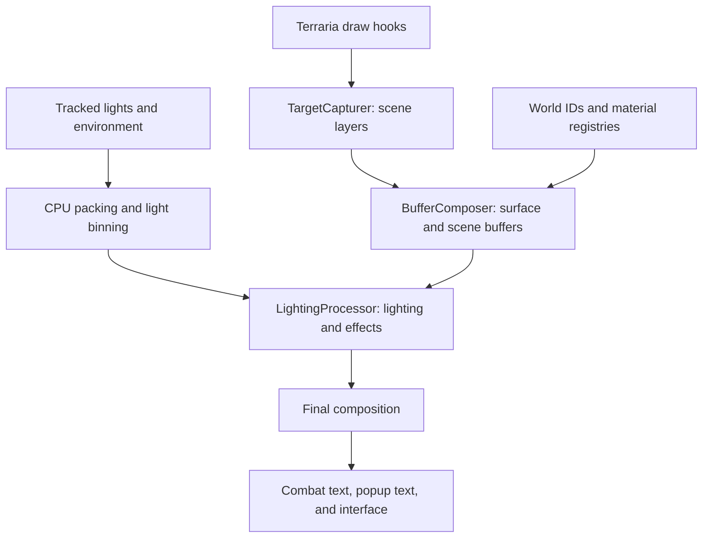

# Terralume

Terralume is a Terraria rendering mod written in C# and HLSL. It introduces physically based material shading, dynamic lighting, reflections, ambient occlusion, bloom, and other effects into the games 2D world.

Physically based shading requires inputs such as albedo, surface normals, material properties, and depth. Terrarias engine does not provide these inputs natively, it is a purely sprite-based renderer.

To bridge that gap, Terralume combines captured draw layers, CPU-side world data, and procedurally generated screen-space buffers. It then uses this information to render a reconstructed version of the original frame.

**Vanilla Terraria**

**Terraria with Terralume**

## Architecture

The renderer is organized into three stages: target capture, data buffer composition, and lighting. CPU-side systems track Terrarias game state and encode relevant data into textures that the GPU can sample during rendering.

### 1. Scene capture

[`TargetCapturer`](Engine/Pipeline/TargetCapturer.cs) hooks into Terrarias draw sequence to capture backgrounds, walls, solid and non-solid tiles, entities, players, projectiles, and liquids into separate render targets. Depending on the content, capture involves copying an existing vanilla target or rendering a draw stage into a dedicated target.

Keeping these layers separate lets later passes identify each pixels role in the scene. A wall and a foreground tile, for example, can receive different depth values and lighting treatment.

This makes draw order part of the renderers architecture. Captures must happen at the right point in Terrarias frame, and intermediate passes must preserve the graphics state expected by the surrounding draw code (This also makes the mod incompatible with other lighting mods that mess with Terrarias rendering pipeline).

### 2. Buffer composition

[`BufferComposer`](Engine/Pipeline/BufferComposer.cs) turns the captured scene and CPU-side world data into a set of buffers for deferred shading. These describe albedo, normals, material properties, reflection properties, layer identity, depth, noise, and tile occlusion. The material buffer stores metallicity, roughness, and emission, while a separate buffer supplies reflection properties.

The layer buffer is built by compositing the captured scene layers, this gives my shaders a way to identify which layer a pixel belongs to. The depth pass then assigns an arbitrary depth value to each layer. Together, these buffers provide a controllable 2.5D representation for lighting without requiring 3D geometry.

Material and reflection registries supply properties for known content. Game IDs connect those definitions to tiles, walls, and liquids on screen, a separate capture path provides material information for supported player armor.

**Layer Buffer**

**Depth Buffer**

**Albedo Buffer**

### 3. Lighting and composition

[`LightingProcessor`](Engine/Pipeline/LightingProcessor.cs) coordinates the final rendering passes before Terraria draws its interface. It gathers point lights from the tracking system, which intercepts calls to Terrarias lighting engine, then packs the lighting data and prepares ambient filtering before running the lighting, bloom, reflection, and output passes.

The radiance pass writes lit color and a bloom mask to multiple render targets. Bloom is then downsampled and blurred multiple times, and then combined. Reflections sample the lit scene. The output shader combines these results and applies tone mapping and gamma controls.

The selected output buffer is drawn to the screen, followed by combat text and popup text. Terraria then draws its interface.

## Key techniques

### Generating normals from existing sprites

Terralume derives surface normals synthetically from the rendered image rather than requiring an authored normal map for each sprite. The [normal shader](Engine/Shaders/Effects/normal.fx) runs over the albedo buffer, converts a 3x3 kernel of samples to luminance, applies a weighted Sobel filter, and constructs a normal from the resulting gradients. After that a blur pass smooths the normal buffer.

This allows surface detail to follow existing textures, which means that Terralume can support any texture pack. The tradeoff is these normals are only an estimate for shape: a highlight can be wrongly interpreted as a change in surface height. Normal strength is configurable to control how strongly this detail affects shading.

**Normal Buffer**

### Encoding material data for the GPU

Material definitions live in CPU-side dictionaries keyed by Terraria content IDs, each key value pair contains a game ID alongside a material vector, for example TileID.Dirt, defines its material as (0.0f, 0.9f, 0.0f).

[`MaterialPacker`](Engine/Mapping/MaterialPacker.cs) encodes these dictionaries into lookup textures, where a pixels index corresponds to a content ID.

[`IDPacker`](Engine/Mapping/IDPacker.cs) Extracts a chunk of the vanilla tile array to capture the tile, wall and liquid IDs for everything currently on screen. It then encodes that data into a tile space lookup texture. I can therefore figure out the game ID of a pixel on the GPU by converting its UV space position to tile space and using that to index the ID texture.

With the ID of a given pixel, I can then retrieve the material property from the material lookup texture and write it into the material buffer.

The material buffer stores metallicity, roughness, and emission in its RGB channels. This separates material behavior from sprite color, two surfaces can use similar colors while responding differently to light.

The material lookup textures are repacked when their definitions are invalidated rather than on every frame. Content without a specific definition uses fallback properties. This keeps the renderer usable with unmapped content, although materials still require manual definitions for full compatability with the renderer.

**Material Buffer**

### Tiled dynamic lighting

Calculating shading for every light against every pixel would make lighting cost grow rapidly in scenes with many lights.

[`LightPacker`](Engine/Mapping/LightPacker.cs) instead divides the screen into 16 × 16 pixel regions and bins lights according to their screen-space range.

The CPU uploads four textures containing light position/range/intensity, light color, per-region offsets and counts, and light indices. The lighting shader uses the current pixels region to find a smaller list of candidate lights.

This reduces the number of light evaluations needed per pixel, at the cost of CPU binning, texture uploads, and storage for the index lists. The implementation also has fixed capacities a region currently accepts at most 255 lights (More than enough), overflow favors earlier entries so later lights will be discarded.

### Physically based shading in a 2D scene

The [radiance shader](Engine/Shaders/Effects/radiance.fx) combines diffuse and specular lighting using a microfacet BRDF with a GGX normal distribution, Smith geometry term, and Schlick Fresnel approximation. Metallicity changes the balance between diffuse and specular response, while roughness controls the spread of the highlight.

Point lights and sunlight use the reconstructed scene information to produce depth and material variation across flat sprites. Ambient lighting adds a diffuse contribution and a directional fill, while emissive materials and volumetric light halos contribute to the final appearance.

The shading model operates on an approximate scene representation. Layer-based depth, generated normals, and visually tuned lighting parameters adapt the model to Terrarias art style.

### Distance fields and reflections

Tile occlusion was one of the harder problems to solve. Light needs to attenuate as it travels deeper into solid tiles. Terraria’s flood-fill lighting handles this naturally as light propagates through the world, but Terralume uses analytical lights. Calculating tile occlusion by ray marching toward every light would be too expensive for a renderer designed to handle thousands of lights (Even though this approach would cast realistic shadows across the scene).

My solution uses a signed distance field to approximate tile occlusion. The renderer runs separate jump-flooding passes for tile and air pixels, propagating nearest-seed information across screen-space buffers. These results are combined into a signed distance field. Pixels inside tiles store their distance to the nearest air pixel, while pixels outside tiles store their distance to the nearest tile pixel.

The lighting shader uses this distance to attenuate light deeper inside solid regions. The same field also shapes ambient occlusion and the volumetric halos around point lights. This replaces per-light visibility tracing with a shared screen-space lookup, trading directional shadows for a cost that is independent of the number of lights.

Reflections use a separate distance field built from the reflective material buffer. A pixel becomes a seed when it is reflective and the pixel directly above it is not, marking the upper boundary of a reflective surface. A vertical-only jump-flooding pass then propagates the nearest seed along the Y axis.

The resulting field gives reflective pixels their vertical distance to the reflection plane. The [reflection shader](Engine/Shaders/Effects/reflection.fx) uses that distance to mirror the reflection sampling coordinates around the surface, replacing a search for the reflection plane with a single texture lookup.

This is a screen-space algorithm tailored to horizontal reflective surfaces. Its accuracy depends on the captured scene and the inferred surface position (Sometimes the reflections artifact when the reflected position is outside of the screen).

### Sun occlusion buffer

Direct sunlight needs to account for terrain beyond the edge of the screen. Terralume estimates sky visibility fully on the CPU by casting a ray upward from each on screen tile through a padded region of the world tilemap. The padding lets terrain outside the camera’s view affect whether a tile receives sunlight.

Each ray has a limited step count and a budget for crossing solid tiles. Air, actuated tiles, and certain tile types such as glass and clouds do not count against that budget.

The resulting visibility values are packed into a texture and mapped back to screen space. The radiance shader samples this buffer to mask the direct sunlight contribution, so each pixel can reuse its tile’s visibility result.

### Ambient filter buffer

A uniform ambient term can brighten sealed underground pockets even when they have no apparent connection to a lit area (This lets the player see through walls). Terralume filters ambient contribution using a reachability pass seeded at the player and at lights whose range and intensity exceed a threshold.

The pass spreads through the on screen tile grid in four directions. It can cross a limited number of solid tiles, and its crossing budget resets when it reaches open space. This lets ambient light follow winding passages and fade through thin barriers while keeping isolated pockets dark.

The renderer packs the resulting weights into a texture, maps them to screen space, and blurs the buffer to soften tile boundaries. The radiance shader uses the buffer to mask ambient lighting independently of direct directional and point lights.

Currently the visibility pass only runs on on-screen tiles, this can cause pockets to pop in/out when the player moves, the fix for this would be to add padding to the visibility search grid and then only pack the tiles on-screen.

**Abient Filter Bufffer**

## Debugging the pipeline

The configuration includes debug views for albedo, normals, depth, materials, layers, noise, reflective materials, sun occlusion, and ambient filtering. These expose intermediate results directly in-game so individual stages can be inspected independently of the final image.

For example, a surface with an unexpected highlight can be checked in both the material and normal views to check whether its properties were generated correctly.

## Limitations and future work

Terralume is currently still in active development. Current limitations include:

- Generated normals approximate shape from brightness and cannot recover the intended geometry of every texture.
- Material coverage depends on manually defined properties, unmapped content uses fallback materials (Content from other mods).
- The mod depends on Terrarias draw sequence and can conflict with other mods that mess with rendering.
- Terrarias screen shader effects currently do not work correctly with the renderer.
- Some underground tile clusters can visibly pop in as the camera moves.

Planned work includes a system for other mods to provide material definitions and broader configuration options.

## Source guide

| Location | Responsibility |
| --- | --- |
| [`Engine/Pipeline`](Engine/Pipeline) | Capture, buffer composition, and lighting orchestration |
| [`Engine/Render`](Engine/Render) | Render pass setup, shader parameters, and draw calls |
| [`Engine/Shaders/Effects`](Engine/Shaders/Effects) | HLSL shader sources and compiled effects |
| [`Engine/Mapping`](Engine/Mapping) | Packing world, material, light, and occlusion data for GPU use |
| [`Engine/Mapping/Registry`](Engine/Mapping/Registry) | Material, reflection, armor, and light definitions |
| [`Engine/Hooks`](Engine/Hooks) | Game-state tracking and rendering modifications |
| [`Engine/Buffers`](Engine/Buffers) | Persistent buffer collections, temporary target caching, and data structures |
| [`Configuration`](Configuration) | Client settings and debug view selection |

## Building

The project uses tModLoaders build integration and imports. The expected source location is `tModLoader/ModSources/Terralume`.

Shader sources (`.fx`) and compiled effects (`.xnb`) are both included. If you wish to make changes to any of the shaders, you must compile them with a program like EasyXNB, and then place them in the effects folder.

## Credits

Created by Sander Diericx.
